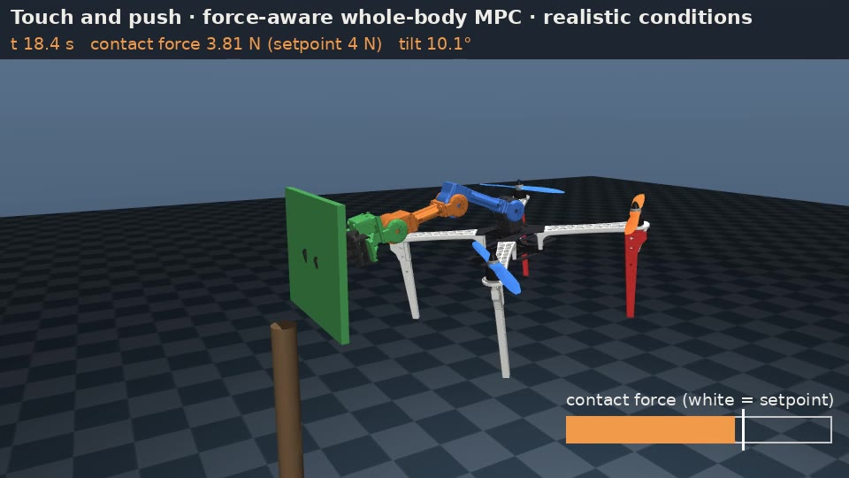
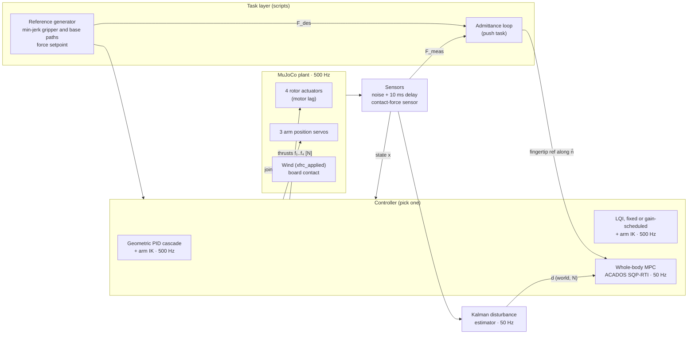
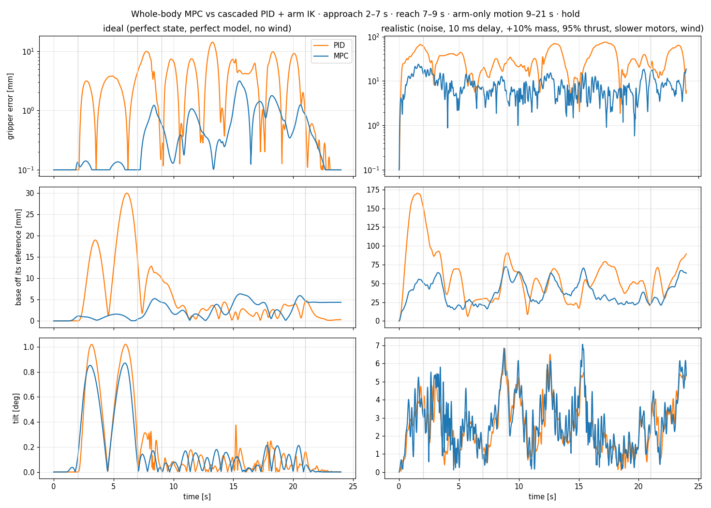
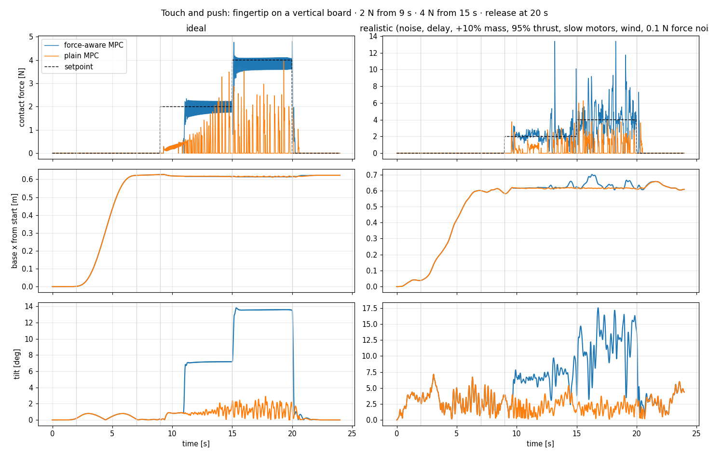

# Aerial manipulation for leaf sample return

Simulation of an **F450 quadrotor with a 3-DoF arm on top** that flies to a plant, reaches with the arm and
touches or presses on a surface. This is the groundwork for leaf sample return.
RAS 593 applied project (ASU, Prof. Jnaneshwar Das), fall 2026.

Everything runs in **MuJoCo 3.3.2** from Python. The controllers write rotor thrusts and arm joint targets
directly to the simulator. On hardware the same commands would go to PX4 (offboard mode) and to the
Dynamixel bus (see [Path to hardware](#path-to-hardware)).



| | |
|---|---|
| **Platform** | DJI F450 frame + DJI E310 propulsion (7.85 N per rotor), ROBOTIS OpenMANIPULATOR-X (3 pitch joints), 1.62 kg total |
| **Controllers** | Geometric PID cascade, LQR/LQI (fixed and gain-scheduled), whole-body MPC (CasADi + ACADOS), admittance force loop, Kalman disturbance estimator |
| **Tasks** | Hover with arm motion, reach to a target pad, gripper trajectory tracking, touch and push on a board with 2 N and 4 N |
| **Test conditions** | "Ideal" and "realistic" (sensor noise, 10 ms delay, +10% mass, 95% thrust, slower motors, gusty wind, force-sensor noise) |

**Contents:**
1. [Install](#install)
2. [How to run](#how-to-run)
3. [Notation: frames, x y z, roll pitch yaw](#notation)
4. [The model](#the-model)
5. [Architecture](#architecture)
6. [Controllers and their equations](#controllers-and-their-equations)
7. [Results](#results)
8. [Code map: where to find what](#code-map)
9. [Path to hardware](#path-to-hardware)
10. [Limitations](#limitations)
11. [Credits and licenses](#credits-and-licenses)

---

## Install

Tested on Ubuntu 24.04 with Python 3.11, without sudo. You need `git`, `cmake`, a C compiler and [uv](https://docs.astral.sh/uv/).

```bash
git clone https://github.com/ibraheem-111/aerial-manipulation-leaf-sampling.git
cd aerial-manipulation-leaf-sampling
bash setup/install_sim.sh       # one time: .venv + this package + ACADOS (pinned commit) in external/acados, about 5 min
```

In every new terminal:

```bash
source setup/env.sh             # activates .venv and sets the ACADOS paths
```

Check that the setup works:

```bash
cd src/uam_quad && python -m pytest -q tests    # 15 tests, about 3 s
```

ROS 2 is **not** needed for the simulation. `setup/install_ros2_jazzy.sh` is there for the later hardware work.

## How to run

All commands run from `src/uam_quad/` after `source setup/env.sh`. Outputs (plots, JSON, videos) go to
`runs/uam_quad/` at the repo root. That folder is not in git. The first MPC run compiles the solver
(about 10 s), and later runs reuse it from `build/`.

### Look at the model

```bash
python scripts/export_xml.py                                   # writes models/*.xml from the Python generator
python -m mujoco.viewer --mjcf=models/f450_omx.xml             # MuJoCo's viewer, no controller (it falls)
python -m mujoco.viewer --mjcf=models/f450_omx_push_scene.xml  # with the push board
```

Viewer controls:

| Action | How |
|---|---|
| Pause / resume | Space |
| Select a body / push it | Double-click it, then Ctrl + right-drag |
| Show contact points and forces | C / F |
| Actuator sliders | Left panel, under Control |

### Fly it live (geometric controller in the loop)

```bash
python scripts/fly.py                          # hover while the arm swings
python scripts/fly.py --arm reach --waypoints  # fly a 1 m square while the arm moves
python scripts/fly.py --no-com-ff              # without centre-of-mass feedforward: watch it drift
python scripts/fly.py --headless --seconds 10  # no window, prints max tilt and hover error
```

### Experiments

| What | Command | Output in `runs/uam_quad/` | Time |
|---|---|---|---|
| Arm swing vs geometric controller | `python scripts/arm_swing_test.py --preset f450_mrs --amp 1.0 --freq 1.0` | `arm_swing_*.png` | 20 s |
| Whole-body MPC reach task | `python scripts/mpc_task.py --video` | `mpc_task_f450_stock_omx.{png,json,mp4}` | 1–2 min |
| MPC with a 4 N sideways push | `python scripts/mpc_task.py --push 4` | `mpc_task_*_push4.*` | 1 min |
| Ablation: MPC without arm coupling | `python scripts/mpc_task.py --fast --no-coupling` | `*_nocpl_fast.*` (it flips) | 1 min |
| PID vs LQR vs MPC, ideal and realistic | `python scripts/compare_controllers.py --video` | `compare/compare.png`, `compare/results.json` | 3–4 min |
| Four-way side-by-side video | `python scripts/video_4way.py` | `compare/compare_4way_realistic.mp4` | 4 min |
| Wind sweep, all controllers | `python scripts/sweep_wind.py` | `compare/wind_sweep*.json`, `wind_sweep.png` | 15–20 min |
| Touch and push (force control) | `python scripts/push_task.py --video` | `push/push.png`, `push/results.json`, `push/push_realistic.mp4` | 3 min |
| Disturbance estimator, 4 seeds | `python scripts/eval_estimator.py` | `estimator/results.json` | 4 min |
| Unit tests (model, equations of motion vs MuJoCo) | `python -m pytest -q tests` | | 3 s |

### Practice for live demos

`practice/` has a MuJoCo cheat sheet ([COMMANDS.md](practice/COMMANDS.md)), 20 questions with answers
([QUESTIONS.md](practice/QUESTIONS.md)) and 12 graded coding exercises:

```bash
cd practice && python check.py              # grades exercises.py
python check.py --solutions                 # reference solutions, 12/12
```

---

## Notation

### Frames

| Frame | Origin | Axes | Used for |
|---|---|---|---|
| **World W** | On the ground | **x** forward (toward the board), **y** left, **z** up. Gravity is −z. | Position p, velocity v, wind, contact force, disturbance estimate d |
| **Body B** | Base origin **O**, the centre of the F450 hub | **x_B** forward (the arm reaches along +x_B), **y_B** left, **z_B** up (the thrust direction) | Angular velocity ω, thrust, moments, arm kinematics |

This is MuJoCo's convention (z up, often called ENU / FLU). PX4 uses NED / FRD (z down), so on hardware
x stays the same and y and z flip sign.

### Roll, pitch, yaw

The attitude is the rotation **R** that maps body vectors into the world frame (v_W = R v_B). It can be
written as three angles, applied as yaw, then pitch, then roll (ZYX):

$$R = R_z(\psi)\,R_y(\theta)\,R_x(\phi)$$

| Angle | Symbol | About | Positive means | Effect on the drone |
|---|---|---|---|---|
| **Roll** | φ (phi) | x_B (forward axis) | Left side up, right side down | Thrust tilts toward −y: the drone accelerates right |
| **Pitch** | θ (theta) | y_B (left axis) | Nose down | Thrust tilts toward +x: the drone accelerates forward |
| **Yaw** | ψ (psi) | z (up) | Nose turns left (counter-clockwise from above) | Heading only; thrust direction unchanged |

For small angles, the forces from tilting the total thrust f ≈ mg are about

$$\ddot x \approx g\,\theta,\qquad \ddot y \approx -g\,\phi,\qquad \ddot z \approx f/m - g.$$

That is why a quadrotor has to tilt to move sideways: it is **underactuated**, with 4 rotor inputs
for 6 degrees of freedom.

How the code stores attitude:
- **Quaternion** q = (w, x, y, z) in `qpos[3:7]`, body → world. It has no singularity, while Euler angles
  have one at θ = ±90°.
- **Controllers** work with R or q directly, never with Euler angles.
- **MPC cost:** penalizes the quaternion's vector part (q_x, q_y, q_z) ≈ ½(φ, θ, ψ) for small angles. So
  "attitude weight (40, 40, 20)" means roll 40, pitch 40, yaw 20.
- **"Tilt" in the results** is the angle between z_B and the world z: arccos(R₃₃).

**Angular velocity** ω = (p, q, r) is about (x_B, y_B, z_B), i.e. roll rate, pitch rate and yaw rate,
in the body frame (`qvel[3:6]`). Linear velocity v is in the world frame (`qvel[0:3]`).

### Arm joints

The three arm joints all rotate about **y_B**, the same axis as pitch. That is why the arm's reaction
torque shows up almost entirely in pitch.

To avoid a clash with pitch θ, this README writes them as **q₁, q₂, q₃**. In the code they are
`th` / `th[0..2]` (MuJoCo joints `arm_j1..3`).
- **Sign:** positive bends the link downward (nose-down sense).
- **Link angles:** link k points at angle φ_k = q₁ + … + q_k in the body x–z plane, with 0 = straight
  forward.
- **Nominal pose:** (q₁, q₂, q₃) = (−0.6, 1.0, 0.4) rad, i.e. shoulder up, elbow down, wrist slightly down.

### Other symbols

| Symbol | Meaning | Code |
|---|---|---|
| m, J | Total mass; inertia about O in B (depends on the arm pose) | `mass_terms`, `mj_fullM` |
| c | Centre of mass relative to O, in B (moves with the arm) | `c` in `wbmpc.py` |
| h | Angular momentum of the arm relative to the base | `h` |
| f = (f₁…f₄) | Rotor thrusts [N], 0 ≤ fᵢ ≤ 7.85 N | `ctrl[0:4]`, `u[:4]` |
| A | Allocation matrix: [Σf, M_x, M_y, M_z] = A f | `UAMConfig.allocation_matrix` |
| p_ee | Fingertip / gripper position, world frame | site `ee`, `wb.f_ee` |
| f_ext | External force on the fingertip (contact), world frame | MPC parameter `p[0:3]` |
| d | Estimated disturbance force on the base, world frame | MPC parameter `p[3:6]`, `DisturbanceKF.d` |
| n̂ | Board normal (pointing into the board) = +x | `N_HAT` |

---

## The model

[`src/uam_quad/uam_quad/model.py`](src/uam_quad/uam_quad/model.py) builds the MuJoCo XML from a
`UAMConfig` dataclass.

**Base:** a free body.
- **Stock F450** (`f450_stock()`): DJI frame (282 g) + E310 motors and props + estimated ESCs, battery and
  avionics = 1.10 kg airframe.
- **Visual meshes:** CTU MRS F450 meshes.
- **Inertia:** motors as point masses on the arms, plus a central box.

**Rotors:** four MuJoCo `general` actuators on sites.
- Thrust acts along z_B.
- Reaction yaw torque is −spin · 0.016 · fᵢ.
- First-order motor lag: τ = 20 ms (`dyntype="filter"`). The lagged thrust is MuJoCo's `act` state.
- PX4 quad-X motor order.

**Arm:** OpenMANIPULATOR-X joints 2–4 (`with_omx_arm()`), using the CAD masses, inertias and meshes.
- Mounted 3 cm above the hub.
- Driven by MuJoCo `position` servos (kp 20 N·m/rad, torque limit 4.1 N·m = XM430-W350 stall torque at 12 V).
- The controllers send joint targets plus a gravity feedforward.
- Fingertip: an 8 mm sphere.

**Physics:** 500 Hz (2 ms step). There is no aerodynamics model. Wind is an external force applied
with `xfrc_applied`.

**Equations of motion** ([docs/eom.md](src/uam_quad/docs/eom.md)): coupled Newton–Euler about the
base origin O, with the arm's moving centre of mass and momentum:

$$
\begin{bmatrix} m I & -m\,\hat c \\ m\,\hat c & J \end{bmatrix}
\begin{bmatrix} a_B \\ \dot\omega \end{bmatrix} =
\begin{bmatrix}
F_B + m g_B - m\,(\omega\times(\omega\times c) + 2\,\omega\times\dot c + \ddot c) \\
M_B + m\,c\times g_B - \dot J\omega - \omega\times J\omega - \dot h - \omega\times h
\end{bmatrix},
\qquad \dot v = R\,a_B
$$

The terms:
- a_B is the base-origin acceleration in B, and g_B = Rᵀ(0, 0, −9.81).
- F_B = (0, 0, Σfᵢ) + Rᵀ f_ext + Rᵀ d.
- M_B = (M_x, M_y, M_z) from A f + r_ee × Rᵀ f_ext.

The **arm coupling** is the set of terms that depend on how the arm moves: ċ, c̈, J̇ and ḣ.
- `tests/test_model.py` checks these equations against MuJoCo's own dynamics.
- `trim.py` computes hover trims (with `mj_inverse`) and linearizes (with `mjd_transitionFD`).

---

## Architecture



- **The "realistic" runs:**
  - The controller uses the nominal model, while the plant is 10% heavier, gives 95% of commanded
    thrust and has 30 ms motors.
  - The sensors add noise and a 10 ms delay.
  - Wind is a gusty Ornstein–Uhlenbeck force on the base.
- **PID and LQR:** the base loop runs every physics step (500 Hz, like an autopilot), and the arm IK
  runs at 50 Hz.
- **MPC:** runs at 50 Hz and holds its command between solves.

---

## Controllers and their equations

### 1. Geometric PID cascade + arm IK (baseline)

`uam_quad/controller.py` → `GeometricController.__call__`. Based on Lee, Leok & McClamroch (2010), "Geometric
tracking control of a quadrotor UAV on SE(3)".

**Outer loop (position → desired force, world frame):**

$$F_d = -k_x e_x - k_v e_v - k_i\!\int e_x\,dt + m g\,e_3 + m\,\ddot p_d,
\qquad e_x = p - p_d,\; e_v = v - v_d$$

- Gains: k_x = m ω_p², k_v = 2 ζ_p ω_p m, k_i = k_x · `pos_ki`.
- Default: ω_p = 2.5 rad/s, ζ_p = 0.9.
- Tuned: ω_p = 3.0, `pos_ki` = 0.8.

**Desired attitude:** this is where roll and pitch come from. The thrust axis must point along F_d,
and yaw ψ_d fixes the heading:

$$b_{3d} = \frac{F_d}{\lVert F_d\rVert},\quad b_{1c} = (\cos\psi_d, \sin\psi_d, 0),\quad
b_{2d} = \frac{b_{3d}\times b_{1c}}{\lVert\cdot\rVert},\quad R_d = [\,b_{2d}\times b_{3d},\; b_{2d},\; b_{3d}\,]$$

**Collective thrust and inner loop (attitude → body moment):**

$$f = F_d\cdot R e_3,\qquad
e_R = \tfrac12\,(R_d^\top R - R^\top R_d)^\vee,\qquad
M = -k_R e_R - k_\Omega\,\omega + \omega\times J\omega \;-\; R^\top\!\big(c_W\times(-mg\,e_3)\big)$$

- The last term is the **CoM feedforward**: it cancels the gravity moment of the arm-shifted centre of
  mass c_W.
- Gains: k_R = J ω_a², k_Ω = 2 ζ_a ω_a J, with ω_a = 18 rad/s, ζ_a = 0.8.

**Allocation:** f_rotors = clip(A⁺ [f; M], 0, f_max).

**Arm:** inverse kinematics from the *measured* base pose, at 50 Hz (`ik()` in `scripts/compare_controllers.py`):

$$q_{arm} = \arg\min_{q_{lo}\le q\le q_{hi}} \big\lVert\, \mathrm{FK}_{xz}(q) - [R^\top(p_{ee,d} - p)]_{xz}\big\rVert^2$$

This controller is decoupled: it never models how the arm's motion pushes the drone. Under noise this
creates a loop: the base wobbles → the IK moves the arm → the arm's reaction moves the base.

### 2. LQR with integral action (LQI), fixed or gain-scheduled

`uam_quad/lqr.py` → `LQIController`.

**Linearization:** around hover at an arm pose q̄ (`hover_trim`), with
`mjd_transitionFD` (discrete time, dt = 2 ms). The state is in MuJoCo's tangent space:

$$\delta x = [\,\delta p,\ \delta r,\ \delta q_{arm},\ \delta v,\ \delta\omega,\ \delta\dot q_{arm},\ \delta f\,]\in\mathbb R^{22},
\qquad z_{k+1} = z_k + dt\,\delta p_k$$

Here δr is the attitude error as a rotation vector, which is ≈ (δφ, δθ, δψ) for small angles, and
δf is the four lagged rotor thrusts. The augmented system and the gain:

$$A_a = \begin{bmatrix} A & 0\\ dt\,C & I\end{bmatrix},\quad B_a = \begin{bmatrix}B\\0\end{bmatrix},\qquad
P = \mathrm{DARE}(A_a, B_a, Q, R),\quad K = (R + B_a^\top P B_a)^{-1} B_a^\top P A_a$$

$$f = f_{trim} - K\,[\delta x;\ z]$$

- **Weights:** Q = diag(position 40, attitude 20, velocity 8, body rate 1, integral 20), R = I.
- **Inputs:** the four rotor thrusts only. The arm uses the same IK as above.

The variants:
- **Fixed:** one gain at q̄. It crashes once the arm swings more than about 1 rad away, because the
  linear model of the arm's effect is wrong there.
- **Arm-blind:** the gain columns for arm angles and rates are zeroed, so the arm is treated as a disturbance.
- **Gain-scheduled** (`schedule_step=0.15`): relinearize and redesign K whenever the arm moves 0.15 rad from
  the last design pose. This is used arm-blind.

### 3. Whole-body MPC

`uam_quad/wbmpc.py` → `WholeBodyModel` (CasADi) and `WholeBodyMPC` (ACADOS).

**State and input:**

$$x = [\,p\ (3),\ q\ (4),\ v\ (3),\ \omega\ (3),\ q_{arm}\ (3),\ \dot q_{arm}\ (3)\,]\in\mathbb R^{19},\qquad
u = [\,f_1..f_4,\ q_{cmd}\ (3)\,]\in\mathbb R^{7}$$

**Model:** the full coupled equations of motion above, written symbolically. Parameters
p = [f_ext, d] (world frame) let the solver plan with a known contact force and the estimated
disturbance. The arm follows a critically damped reference model:

$$\ddot q_{arm} = \omega_a^2\,(q_{cmd} - q_{arm}) - 2\,\omega_a\,\dot q_{arm}\qquad(\omega_a = 25\ \text{rad/s})$$

The stiff joint servos track this model, with gravity feedforward. Because the MPC knows q̈_arm, it
**predicts the arm's reaction torque and centre-of-mass shift** and tilts or throttles the rotors ahead of time.

**Optimal control problem**, solved every 20 ms. The horizon is N = 25 steps × 0.04 s = 1 s:

$$\min_{u_0..u_{N-1}}\ \sum_{k=0}^{N-1}\lVert y(x_k,u_k) - y_k^{ref}\rVert_W^2 + \lVert y_N(x_N) - y_N^{ref}\rVert_{5W}^2
\quad\text{s.t.}\quad x_{k+1} = \Phi_{RK4}(x_k,u_k,p),\ x_0 = \hat x$$

$$y = [\,p_{ee}(x),\ p,\ (q_x,q_y,q_z),\ v,\ \omega,\ q_{arm},\ \dot q_{arm},\ f,\ q_{cmd}\,]$$

$$W = \mathrm{diag}(\underbrace{400}_{\text{gripper}},\ \underbrace{200}_{\text{base}},\ \underbrace{40,40,20}_{\text{roll, pitch, yaw}},\ \underbrace{4}_{v},\ \underbrace{1}_{\omega},\ 0.02,\ 0.002,\ 0.02,\ 0.02)$$

**Constraints:**
- 0 ≤ fᵢ ≤ 7.85 N.
- Joint limits on q_arm and q_cmd.
- |q_x|, |q_y| ≤ 0.6, a tilt sanity bound.

**Solver:** SQP-RTI (one QP per step), Gauss–Newton Hessian, HPIPM, explicit RK4. The median solve is
**2.5 ms**.

**Offset-free tracking:** the nominal model is wrong in the realistic runs. There are two options:
- **(a)** An integrator on the gripper error that shifts the gripper reference (`mpc`).
- **(b)** The Kalman disturbance estimate d passed in as a parameter (`mpc_kf`, section 5).

### 4. Force control for touch and push (admittance + force-aware MPC)

`scripts/push_task.py`. The fingertip pushes on a vertical board along n̂ = +x (world).

**Force measurement:** the force comes from MuJoCo's contact solver (`mj_contactForce`), a stand-in
for a fingertip force sensor. It is low-pass filtered with τ = 30 ms. In the realistic runs it also
has 0.1 N noise.

**Admittance loop** (50 Hz): the fingertip reference moves into the board until the force matches the
setpoint:

$$\dot\delta = k_a\,(F_{des} - F_{meas}),\quad k_a = 0.006\ \tfrac{\text{m/s}}{\text{N}},\quad \delta\in[-0.01, 0.05]\ \text{m},\qquad
p_{ee}^{ref} = p_{pre} + \hat n\,(0.01 + \delta)$$

**Contact detection with hysteresis:**
- Contact is declared when F_meas > 0.3 N.
- It is released only after F_meas < 0.1 N for 0.1 s.

This stops noise from switching the feedforward on and off.

**Force-aware MPC:** while in contact, the MPC is told f_ext = −n̂ F_des, the board pushing back on the
fingertip. So it plans the lean (about 14° at 4 N) instead of being pushed off. The "plain MPC" variant
treats the push as an unknown disturbance.

### 5. Kalman disturbance estimator

`uam_quad/estimator.py` → `DisturbanceKF`.

**What it estimates, and in which frame.** d = (d_x, d_y, d_z) is **one force vector, in newtons, in
the world frame W** (x forward toward the board, y left, z up), acting at the base origin O. It lumps
together everything the MPC's nominal model gets wrong about the forces on the drone:
- wind (mostly d_x, d_y)
- the airframe being heavier than modelled, or rotors giving less thrust than commanded (both show up
  as negative d_z)
- contact-force error

It does not estimate torques.

**How it estimates d.** It compares how the drone *actually* moved with how the nominal model says it
should have moved. Any steady difference must come from an extra force. Each world axis i ∈ {x, y, z}
has its own 3-state filter:

$$s = [\,p_i,\ v_i,\ d_i\,],\qquad
s_{k+1} = \begin{bmatrix}1 & dt & \tfrac{dt^2}{2m}\\ 0 & 1 & \tfrac{dt}{m}\\ 0&0&1\end{bmatrix}s_k
+ \begin{bmatrix}\tfrac{dt^2}{2}\\ dt\\ 0\end{bmatrix}a_{i,k} + w_k,\qquad
z_k = [\,p_i,\ v_i\,] + \nu_k$$

**Prediction term.** a_k is the acceleration the nominal model predicts (`WholeBodyModel.f_dyn`) from:
- the measured state
- the rotor thrusts as they really are after the motor lag: f̂ ← f̂ + (1 − e^{−dt/τ_m})(f_cmd − f̂)
- the measured contact force

Anything the model already explains is inside a_k, so d only picks up what it misses. Getting the
motor lag right matters: without it, the filter reads every throttle change as a disturbance.

**Noise settings:**

$$Q = \mathrm{diag}\big((\tfrac12\sigma_a dt^2)^2,\ (\sigma_a dt)^2,\ \sigma_d^2\,dt\big),\quad
R = \mathrm{diag}(\sigma_p^2, \sigma_v^2)$$

- σ_a = 1 m/s² is the unmodelled acceleration.
- σ_d = 0.3 N/√s is how fast d may drift.
- σ_p = 2 mm and σ_v = 0.02 m/s are the sensor noise.
- d is clipped to ±8 N.

**How it is used.** `mpc.set_disturbance(d)` adds Rᵀd to the force in the MPC model, so the MPC plans
against it. In contact, the component along the board normal is removed (d − n̂(n̂·d)): the admittance
loop owns the force error along n̂, and two loops fighting over the same axis made contact worse.

Sanity check: with the plant 10% heavier and at 95% thrust, the expected d_z is about −2.4 N, and the
filter settles at −2.0 to −2.5 N. With 0.335 N mean wind it reads d_x of about 0.6–1.0 N, including the gusts.

---

## Results

All numbers come from the scripts above. Each JSON file is in `runs/uam_quad/` after you run the script.
Videos and plots are in [`docs/media/`](docs/media).

### Arm-driven gripper tracking (`compare_controllers.py`, gripper RMS error while the arm moves)

| Controller | Ideal | Realistic (2 seeds) |
|---|---|---|
| PID (default) + IK | 5.6 mm | crashes (5 of 5 runs) |
| PID (tuned) + IK | 5.6 mm | 27 mm |
| LQR (fixed) + IK | crashes | crashes |
| LQR (gain-scheduled, arm-blind) + IK | 5.5 mm | 30 mm |
| **Whole-body MPC** | **1.1 mm** | **7 mm** |

**Wind sweep** (`sweep_wind.py`): only the MPC survives a mean wind above 0.75 N. It still flies at
3.5 N mean with 5 N gusts, with 202 mm gripper error and 1 crash in 2 runs. For scale, the drone weighs 15.9 N.



### Touch and push (`push_task.py`)

Fingertip on a vertical board: 2 N from 9 s, 4 N from 15 s, release at 20 s. "Contact lost" is the share
of the 11–20 s push window with under 0.05 N.

| Run | 2 N phase, mean force | 4 N phase, mean force | Contact lost | Max tilt |
|---|---|---|---|---|
| **Force-aware MPC, ideal** | **1.97 N** (RMS error 0.28) | **3.84 N** (RMS error 0.29) | **0%** | 13.8° |
| Plain MPC, ideal | 0.38 N | 0.43 N | 70% | 2.9° |
| **Force-aware MPC, realistic (4 seeds)** | **2.16 N** | **3.75 N** | **6.6%** (3.8–10% per seed) | 18.9° |
| Plain MPC, realistic | 0.50 N | 0.70 N | 60% | 7.1° |

What made realistic contact work was **contact detection with hysteresis**. Before it, the force feedforward
switched on and off with the noisy force signal, and contact was lost 45% of the time.



### Disturbance estimator (`eval_estimator.py`, realistic conditions, 4 seeds)

**Free flight** (arm-driven tracking task):

| Offset-free method | Gripper RMS | Base deviation RMS | Max tilt | Crashes |
|---|---|---|---|---|
| MPC + integrator on the gripper error | 9.1 mm | 41.9 mm | 6.9° | 0 / 4 |
| **MPC + Kalman estimator** | **8.9 mm** | **21.9 mm** | 8.0° | 0 / 4 |

The estimator **halves base drift** with the same gripper accuracy. It finds the injected errors:
d_z = −2.0 to −2.5 N (−2.4 N expected from the mass and thrust mismatch), and d_x = 0.2 to 1.0 N of wind.

**Touch and push** (force-aware MPC, realistic). The estimate never acts along the board normal:

| Estimator use in contact | Contact lost | 4 N phase, mean force | Max tilt |
|---|---|---|---|
| **None (final design)** | **6.6%** | 3.75 N | 18.9° |
| Live estimate on y and z | 16.8% (one seed 40%) | 3.62 N | 22.2° |
| Live estimate on z only | 9.8% | 3.61 N | 18.5° |
| Free-flight estimate held during contact | 30.9% | 3.33 N | 35.6° |

In contact, every variant was worse than leaving the estimate out, so the final design is:
- **Free flight:** the estimator runs and feeds the MPC.
- **Pushing:** hysteresis + admittance + force feedforward.

A likely reason (not yet tested) is that in contact the board adds friction and a torque about the hub
through the arm. A force-only estimate at the hub can't represent either. The next step is a 6-D
(force + torque) estimate with a 3-axis fingertip force sensor.

Videos:
- [MPC reach task](docs/media/mpc_task.mp4)
- [PID / LQR / MPC side by side, realistic](docs/media/compare_4way_realistic.mp4)
- [Touch and push, realistic](docs/media/push_realistic.mp4)

---

## Code map

Package root: `src/uam_quad/`.

| I want… | File | Look for |
|---|---|---|
| Physical parameters (mass, thrust, arm, servo gains) | `uam_quad/model.py` | `UAMConfig`, `f450_stock()`, `f450_mrs()` |
| The MuJoCo XML generator | `uam_quad/model.py` | `build_mjcf()`, `load_model()` |
| Rotor allocation matrix A | `uam_quad/model.py` | `UAMConfig.allocation_matrix()` |
| Arm (OpenMANIPULATOR-X) geometry, masses, meshes | `uam_quad/omx_arm.py`, `assets/arm/` | `arm_xml()`, `arm_spec.json`, `build_arm.py` |
| Equations of motion (NumPy) and the check vs MuJoCo | `uam_quad/eom.py`, `docs/eom.md` | `mass_terms()`, `base_accelerations()`, `check_against_mujoco()` |
| Hover trim, linearization, controllability | `uam_quad/trim.py` | `hover_trim()`, `linearize()`, `controllability_rank()` |
| Geometric PID cascade | `uam_quad/controller.py` | `GeometricController.__call__`, `Gains` |
| LQR / LQI, gain scheduling | `uam_quad/lqr.py` | `LQIController._design()` (DARE), `__call__` (scheduling) |
| Whole-body MPC model (CasADi) | `uam_quad/wbmpc.py` | `WholeBodyModel.__init__` (EOM, arm reference model) |
| MPC cost, constraints, solver settings | `uam_quad/wbmpc.py` | `WholeBodyMPC.__init__` (`W`, `lbu/ubu`, `SQP_RTI`) |
| MPC references, contact force and disturbance inputs | `uam_quad/wbmpc.py` | `set_trajectory()`, `set_contact_force()`, `set_disturbance()` |
| Arm servo reference model + gravity feedforward | `uam_quad/wbmpc.py`, scripts | `ArmReference`; `data.ctrl[n:] = th_r + qfrc_bias/servo_kp` |
| Kalman disturbance estimator | `uam_quad/estimator.py` | `DisturbanceKF.update()` |
| Old velocity observer (failed, kept for reference) | `uam_quad/wbmpc.py` | `DisturbanceObserver` |
| Arm IK for the PID/LQR baselines | `scripts/compare_controllers.py` | `ik()` |
| Sensor noise and delay, model mismatch, wind | `scripts/compare_controllers.py` | `Sensors`, `run()` (`realistic=True`) |
| Admittance loop, contact detection, force feedforward | `scripts/push_task.py` | `run()`: `k_adm`, `CONTACT_ON`, `set_contact_force` |
| Contact-force "sensor" | `scripts/push_task.py` | `contact_force()` (`mj_contactForce`) |
| Paths for outputs and solver builds | `uam_quad/paths.py` | `RUNS`, `BUILD` |
| Tests | `tests/test_model.py` | model, trim, EOM vs MuJoCo, MPC model vs MuJoCo |
| Background notes, all results, tuning lessons | `docs/` | `eom.md`, `control_fundamentals.md`, `wbmpc.md` |

Repository layout:

```
README.md                 this file
setup/                    install_sim.sh (venv + ACADOS), env.sh (source per terminal), install_ros2_jazzy.sh
src/uam_quad/             Python package
  uam_quad/               model, eom, trim, controller, lqr, wbmpc, estimator, paths
  scripts/                runnable experiments (see "How to run")
  tests/                  pytest
  models/                 exported MuJoCo XML (open with python -m mujoco.viewer)
  assets/                 F450 and OpenMANIPULATOR-X meshes
  docs/                   equations of motion, control background, MPC notes and results
docs/media/               result plots and videos
practice/                 MuJoCo cheat sheet, Q&A, graded exercises
-- created locally, not in git --
.venv/  external/acados/  build/ (generated solver code)  runs/ (experiment outputs)
```

---

## Path to hardware

| In simulation | On the real F450 |
|---|---|
| The MPC writes 4 rotor thrusts to MuJoCo actuators | MPC → collective thrust + body rates (p, q, r) → PX4 offboard (`VehicleRatesSetpoint`) via ROS 2 / uXRCE-DDS. PX4 runs the rate loop and the mixer. Convert ENU/FLU → NED/FRD. |
| Joint targets to MuJoCo position servos | Joint targets to Dynamixel XM430s over the U2D2 bus (position mode, ~100 Hz) |
| State straight from the simulator (+ noise) | PX4 EKF2 + motion capture or VIO for pose, Dynamixel encoders for the arm |
| Contact force from `mj_contactForce` | Fingertip load cell or force-sensitive resistor, or estimated from servo currents |

Weigh the real airframe and thrust-test the motors, then override `f450_stock(base_mass=..., thrust_max=...)`.

## Limitations

- **Masses:** the F450 battery, ESC and avionics masses are estimates, not measurements.
- **Aerodynamics:** none. There is no downwash, ground effect or rotor drag. Wind is a force at the hub.
- **Arm:** planar (3 pitch joints), so it can't reach sideways without yawing the drone. There is no gripper
  yet: the fingertip is a sphere.
- **Force sensing:** contact force comes from the simulator. A real sensor will be noisier and slower.
- **Estimator:** it estimates force only, not torque. In contact it is limited to the axes along the board.

## Credits and licenses

- F450 meshes and reference parameters: [CTU MRS UAV Gazebo simulator](https://github.com/ctu-mrs/mrs_uav_gazebo_simulator) (BSD-3-Clause), see `src/uam_quad/assets/f450/README.md`.
- OpenMANIPULATOR-X meshes and masses: [ROBOTIS open_manipulator](https://github.com/ROBOTIS-GIT/open_manipulator) (Apache-2.0), see `src/uam_quad/assets/arm/README.md`.
- [MuJoCo](https://mujoco.org), [CasADi](https://web.casadi.org), [ACADOS](https://docs.acados.org).
- Background:
  - T. Lee, M. Leok, N. H. McClamroch, *Geometric tracking control of a quadrotor UAV on SE(3)*, CDC 2010.
  - UMI-on-Air (arXiv 2510.02614): an inspiration for embodiment-aware aerial manipulation.
  - Flying Hand (L1-adaptive whole-body control).
